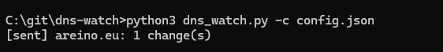

# dns-watch

Command-line tool that resolves a list of domains directly against their **authoritative nameservers**, keeps a local baseline, and sends a **Taegis event via HTTP Ingest** whenever a record changes.

## Install

```
pip install -r requirements.txt
```

Requires Python 3.8+ and `dnspython`.

## Configuration

Copy `config.example.json` to `config.json` and edit:

```json
{
  "domains": ["example.com", "www.example.com"],
  "record_types": ["A", "AAAA", "CNAME", "MX", "NS", "TXT"],
  "state_file": "dns_state.json",
  "timeout": 5,
  "taegis": {
    "url": "https://<your-taegis-http-ingest-endpoint>",
    "token_env": "TAEGIS_TOKEN",
    "headers": {},
    "timeout": 15
  }
}
```

| Key | Required | Description |
|-----|----------|-------------|
| `domains` | yes | Names to monitor (apex or subdomains). |
| `record_types` | no | Record types to query. Default: A, AAAA, CNAME, MX, NS, TXT. |
| `state_file` | no | Where the baseline is stored. Default: `dns_state.json`. |
| `timeout` | no | Per-query DNS timeout in seconds. Default: 5. |
| `taegis.url` | for alerting | HTTP Ingest endpoint. |
| `taegis.token_env` | no | **Name** of the environment variable that holds the key (not the key itself). Sent as `Authorization: Bearer <key>`. Default: `TAEGIS_TOKEN`. |
| `taegis.token` | no | The key itself, inline. Takes precedence over `token_env`. Convenient for testing; keep the file private. |
| `taegis.headers` | no | Extra HTTP headers (merged over the defaults). |
| `taegis.timeout` | no | HTTP timeout in seconds. Default: 15. |

The token is read from the environment so it never lives in the config file:

```powershell
$env:TAEGIS_TOKEN = "..."
```

## Usage

```
python dns_watch.py -c config.json              # baseline on first run, compare afterwards
python dns_watch.py -c config.json --first-run  # rebuild the baseline, send no events
python dns_watch.py -c config.json --dry-run    # print events, send nothing, leave state untouched
python dns_watch.py -c config.json -v           # log the full HTTP request (token redacted) and response
```



Send errors always include the HTTP status, response body and headers, and say where the token came from (or that it was not found).

## How it works

1. For each domain, find its zone and the zone's NS hosts (via the system resolver), then resolve those hosts to IPs.
2. Query each requested record type **directly on an authoritative server** (UDP, TCP fallback on truncation). The first server that answers is used.
3. **First run** (no state file, or `--first-run`): store the results and send nothing.
4. **Later runs**: compare against the stored state. Each changed domain produces one event. Domains newly added to the config are quietly added to the baseline.
5. After a successful send, the new state is saved.

CNAMEs in the answer are recorded under `CNAME`. An `NXDOMAIN` is stored as status `NXDOMAIN`, so a domain appearing or disappearing is itself a change.

## Event format

One JSON object per POST:

```json
{
  "timestamp": "2026-11-25T16:31:36+00:00",
  "source": "dns-watch",
  "event_type": "dns_record_change",
  "domain": "example.com",
  "zone": "example.com",
  "answered_by": "elliott.ns.cloudflare.com (162.159.44.228)",
  "title": "DNS records changed for example.com",
  "summary": "example.com: A: +1 -1",
  "severity": "MEDIUM",
  "changes": [
    { "field": "A", "added": ["172.66.147.243"], "removed": ["9.9.9.9"] }
  ],
  "previous": { "...": "full previous state for the domain" },
  "current":  { "...": "full current state for the domain" }
}
```

A status change appears as `{"field": "status", "previous": "NOERROR", "current": "NXDOMAIN"}`.

Each event is sent as a single compact JSON line terminated by `\n` (`Content-Type: application/json`). Taegis HTTP Ingest delimits records by line feed, so an unterminated record may not be processed.

`title`, `summary` and `severity` are built by `dns_watch.py` so the Taegis parser only needs to map fields. Severity is `HIGH` when an NS record or the domain status changes, and `MEDIUM` otherwise (`severity_for()`).

If your Taegis ingest expects a different schema or framing (for example NDJSON), adjust `send_event()` and the event dict in `main()` in `dns_watch.py`.

## Taegis custom parser

`taegis_parser.txt` is a Taegis custom parser that turns the ingested event into a third-party alert (`thirdpartyalert` schema).

To install it:

1. In Taegis XDR, go to the Custom Parsers page and create a new parser.
2. Paste the contents of `taegis_parser.txt`. The `!SAMPLE=` line holds a sample event for testing.
3. Run the parser test and check the output fields, then save and enable it.

What it maps:

| Event field | Taegis field |
|-------------|--------------|
| `timestamp` | `eventTimeUsec$`, `firstEventTimeUsec$`, `lastEventTimeUsec$` |
| `title` | `title$` |
| `summary` | `summary$` |
| `severity` | `severity$`, `vendorSeverity$` |
| `domain` | `domainName$` |
| `answered_by` | `sourceHostName$` |

The parser also sets fixed values for `alertCategory$`, `vendor$`, `provider$`, `logType$` and `sensorType$`. It only matches events containing `"event_type": "dns_record_change"`.

Not verified in a live tenant. Check these when testing:

- `severity$` is assigned the string `HIGH` or `MEDIUM`. The Taegis docs list the enum (`UNKNOWN_SEVERITY` to `CRITICAL`) but don't show how to assign it. If the test rejects the string, send a number from the event instead (3 for `MEDIUM`, 4 for `HIGH`).
- The timestamp uses `DATETIME` with the Go layout `2006-01-02T15:04:05Z07:00`. Confirm the parsed time is correct.
- `isCustomAlert$` and `additionalData$` are not set because the docs don't show their value formats. If events don't surface as alerts, start there.

Reference: [Thirdparty schema](https://docs.taegis.secureworks.com/integration/customParsers/schema_thirdparty/), [Custom parser syntax](https://docs.taegis.secureworks.com/integration/customParsers/custom_parsers_syntax/).

## Failure behavior

- **No authoritative server answers** for a domain: it is skipped, its previous state is kept, no event is sent, and the run exits with code 1.
- **Event send fails**: that domain's state is *not* updated, so the change is detected and retried on the next run. Exit code 1.
- **No `taegis` block configured**: changes are printed to stdout and state is not updated.
- Exit code is `0` when everything succeeded (with or without changes).

## Scheduling

Run it periodically, for example with Windows Task Scheduler:

```
schtasks /Create /SC MINUTE /MO 15 /TN "dns-watch" /TR "python C:\git\dns-watch\dns_watch.py -c C:\git\dns-watch\config.json"
```

Set `TAEGIS_TOKEN` in the task's environment, or as a system or user environment variable. On Linux, use cron or a systemd timer.

## Notes

- Zone discovery and NS address lookups use the system resolver; only the actual record queries go to the authoritative servers.
- Round-robin or geo-DNS records that legitimately vary between queries will look like changes. Avoid monitoring such names, or drop the affected record types from `record_types`.
- Keep `dns_state.json` and `config.json` out of version control if they contain anything sensitive.
